<!-- Assets in ./assets are generated by scripts/build_assets.py (light + dark). Edit text there and re-run. -->

<a href="https://byte-kappa.vercel.app/#work">
  <picture>
    <source media="(prefers-color-scheme: dark)" srcset="assets/hero-dark.svg">
    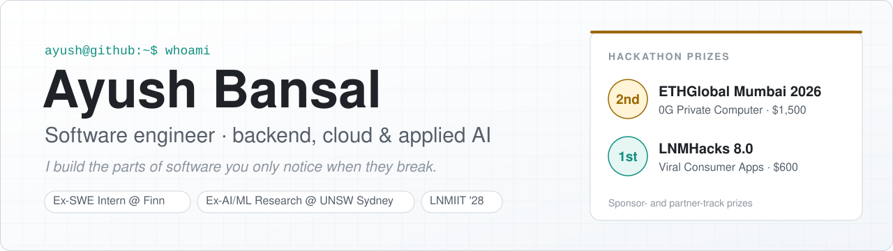
  </picture>
</a>

  <a href="https://byte-kappa.vercel.app/#work"><b>Portfolio</b></a>&nbsp;&nbsp;·&nbsp;&nbsp;
  <a href="https://www.linkedin.com/in/ayush-bansal-21b12a311/">LinkedIn</a>&nbsp;&nbsp;·&nbsp;&nbsp;
  <a href="mailto:ab262133@gmail.com">ab262133@gmail.com</a>&nbsp;&nbsp;·&nbsp;&nbsp;
  <a href="#selected-work">Selected work</a>

I like the part of engineering that happens after the demo works: making an AI agent refuse a bad trade, making a deploy roll itself back, finding out why a model scores 0%. This summer that meant shipping production code at **[Finn](https://github.com/finn)**, an AI voice-agent startup, and debugging an ML research pipeline at **UNSW Sydney**. In between, my team's agent **SAKA** took 2nd place in 0G's track at **ETHGlobal Mumbai 2026**.

I'm a B.Tech ECE student at LNMIIT (graduating 2028), looking for **software, backend, cloud/platform and AI engineering internships** in India, remote or abroad.

 

---

<a href="https://ethglobal.com/showcase/saka-defi-ai-agent-gbb53">
  <picture>
    <source media="(prefers-color-scheme: dark)" srcset="assets/saka-header-dark.svg">
    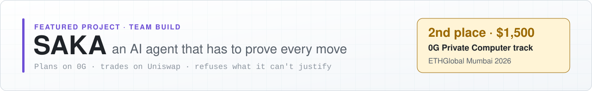
  </picture>
</a>

<a href="https://saka-rust.vercel.app">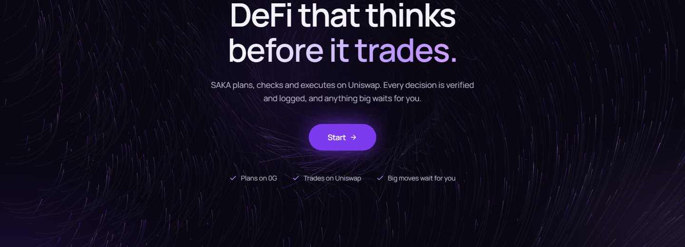</a>

**The problem:** an AI agent that can move money is only useful if you can trust it not to. SAKA lets you say *"swap $5 of ETH to USDC"* in plain English, then makes every request earn its way to execution, and explains itself when it says no.

<picture>
  <source media="(prefers-color-scheme: dark)" srcset="assets/saka-pipeline-dark.svg">
  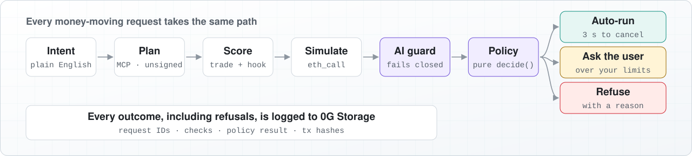
</picture>

  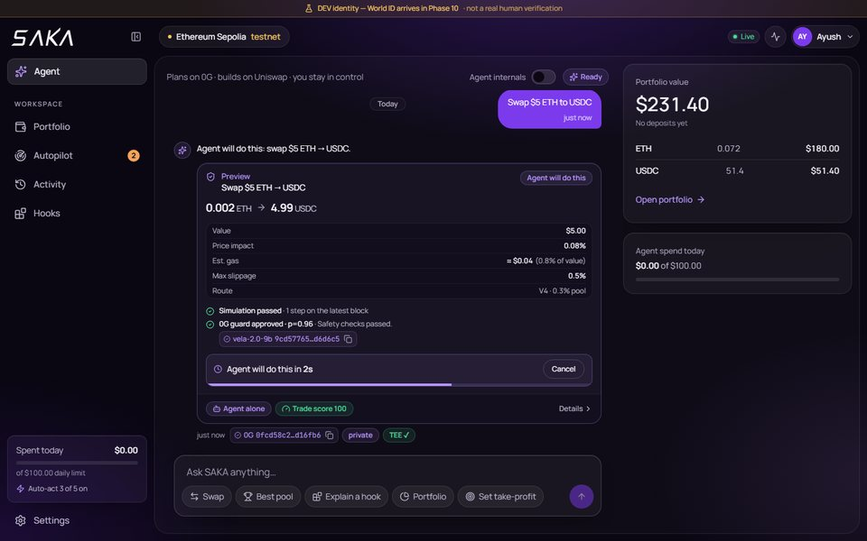
  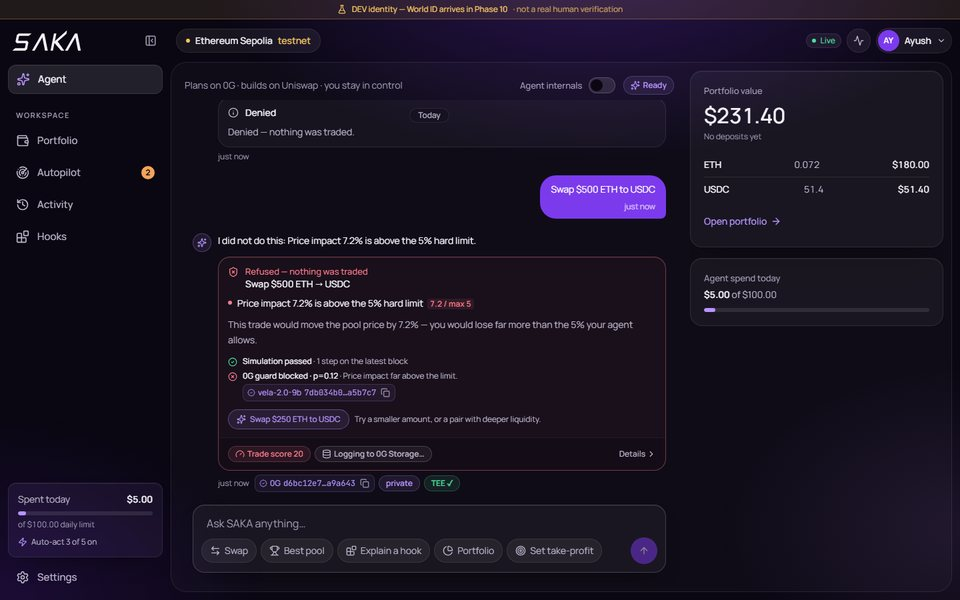
  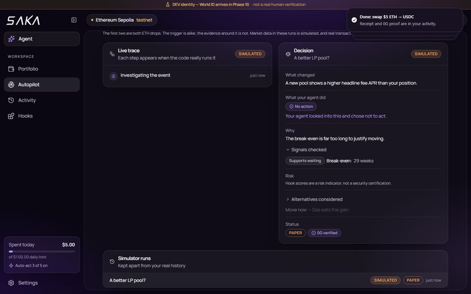

Left to right: a small swap auto-runs after a 3-second cancel window · a $500 swap is refused for 7.2% price impact · the simulator, where "no action" is a real decision. Screenshots from the repo; they use mock data.

- **It can't sign, by design.** The 16-tool Uniswap MCP server only builds unsigned transactions, and a test fails the build if signing code ever lands in it.
- **It fails closed.** If the guard model on 0G is unreachable, the answer is no.
- **It comes to you.** A BullMQ worker runs 9 detectors per funded wallet every 60 s and proposes actions in the app and on Telegram.
- **It leaves a receipt.** Every decision, refusals included, is stored on 0G Storage with its inference request IDs, checks and tx hashes.
- **It's tested.** 600+ Vitest tests; the planner is evaluated on 35 live cases (32 pass).

<b>Stack</b> · TypeScript · React · Fastify · PostgreSQL (Prisma) · Redis · BullMQ · Privy · 0G · Uniswap v4 · Docker · Azure · Vercel. Executes on the Sepolia testnet; mainnet is read-only for market data. Built with Komal Jeengar and Saksham Garg.

**[Code](https://github.com/Ayush-Bansal08/SAKA)** · **[Live demo](https://saka-rust.vercel.app)** · **[ETHGlobal showcase](https://ethglobal.com/showcase/saka-defi-ai-agent-gbb53)** · **[Case study](https://byte-kappa.vercel.app/#work)**

---

## Selected work

### Helios: an internal developer platform on Kubernetes

<picture>
  <source media="(prefers-color-scheme: dark)" srcset="assets/helios-dark.svg">
  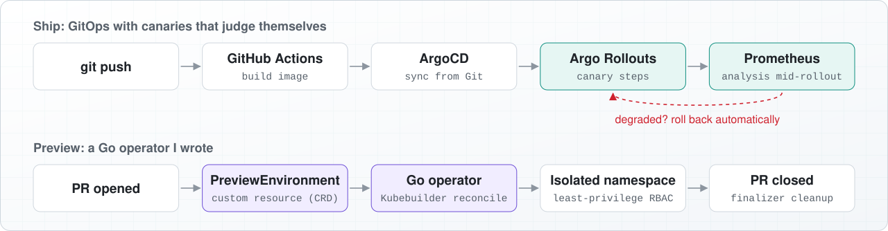
</picture>

The platform *around* the app. Releases judge themselves against live Prometheus metrics and roll back on their own, and every pull request can get its own preview environment from a **custom Go operator I wrote with Kubebuilder**. It runs on k3s on Azure with Let's Encrypt TLS, is hardened with Trivy, Kyverno and Falco, and autoscaling was load-tested with k6. A second, unrelated app onboarded with zero platform changes.

Go · Kubernetes · ArgoCD · Argo Rollouts · Prometheus · Grafana · Kyverno · Azure &nbsp; **[Code](https://github.com/Ayush-Bansal08/k8s-project)** · **[Demo video](https://drive.google.com/file/d/14-x45ra9iRBMOevZ0CqfLridM_HQqiSa/view?usp=sharing)**

### DockHealer: an LLM that has to pass a build before anyone trusts it

<picture>
  <source media="(prefers-color-scheme: dark)" srcset="assets/dockhealer-dark.svg">
  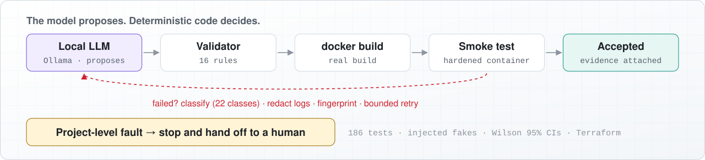
</picture>

A Python CLI that treats the model as an unreliable component inside a deterministic harness. The repair loop always terminates, build logs are fenced as untrusted data against prompt injection, and project source isn't sent to a third-party service. **186 tests** with injected fakes, a failure-injection harness with Wilson confidence intervals, and Terraform for an Azure test VM.

Python · Docker · Ollama · Terraform · Azure · GitHub Actions · pytest &nbsp; **[Code](https://github.com/Ayush-Bansal08/Dockhealer)**

### PollForge: an event-driven voting platform on Azure Kubernetes Service

<picture>
  <source media="(prefers-color-scheme: dark)" srcset="assets/pollforge-dark.svg">
  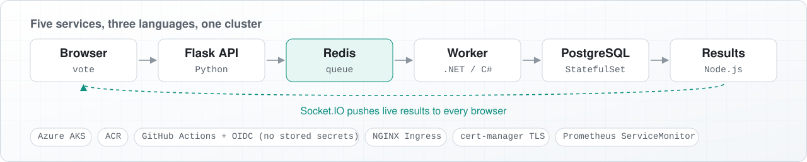
</picture>

A small product split across Python, C# and Node.js, deployed to AKS. The CI/CD authenticates with OIDC, so no cloud secrets are stored anywhere. Postgres runs as a StatefulSet that survived deliberate pod kills. The README documents the consistency model and where it would still need hardening for production.

Python · C#/.NET · Node.js · Redis · PostgreSQL · Kubernetes · Azure AKS/ACR &nbsp; **[Code](https://github.com/Ayush-Bansal08/PollForge)** · **[Demo video](https://drive.google.com/file/d/1pVh277Bao5hEftS_H58uTEaM6GU1tDl0/view?usp=sharing)**

### SOM-Gold: hyperspectral mineral exploration (UNSW Sydney research)

<picture>
  <source media="(prefers-color-scheme: dark)" srcset="assets/research-dark.svg">
  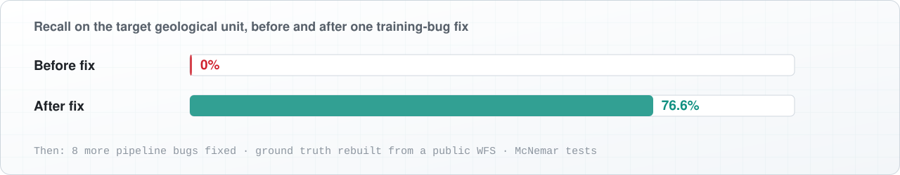
</picture>

Self-organising maps versus k-means with PCA and autoencoders, on EnMAP hyperspectral and Sentinel-2 imagery of the Tibooburra region, NSW. The model wasn't the problem; a training bug was. After fixing it I audited the whole pipeline (a wrong Cohen's κ, mismatched autoencoder masks, unseeded RNGs), rebuilt the ground truth from a public government WFS so results regenerate from source, and added McNemar significance tests, stability analysis and ablations. The paper is under review.

Python · PyTorch · scikit-learn · NumPy · geospatial data &nbsp; **[Research code](https://github.com/sydney-machine-learning/remotesensing-SOM)**

---

## Experience

**Software Engineering Intern · Finn (Airforge Tech)** · Bengaluru · May – Jul 2026 
25+ merged PRs across 5+ production services: AI voice agents, REST APIs, authentication, WhatsApp automation, deployment infrastructure and customer dashboards. Built LLM agent workflows and event-driven backend services, and shipped to staging and production twice a week with Docker, Kubernetes, Nginx and CI/CD.

**AI/ML Research Intern · UNSW Sydney** · with Dr. Rohitash Chandra · remote · May – Aug 2026 
Unsupervised ML on hyperspectral satellite data for gold exploration. Took target-unit recall from 0% to 76.6% by fixing a training bug, fixed 8 more pipeline bugs, and built the evaluation framework. Paper under review.

## Recognition

| Event | Result |
| --- | --- |
| 🥈 **ETHGlobal Mumbai 2026** | 2nd place, 0G Private Computer track · $1,500 · [SAKA](https://ethglobal.com/showcase/saka-defi-ai-agent-gbb53) |
| 🥇 **LNMHacks 8.0** · Jan 2026 | 1st place, Viral Consumer Apps partner track · $600 · 500+ participants |

## What I work with

**Daily drivers** — Python · TypeScript · Go · Node.js · PostgreSQL · Redis · Docker · Kubernetes 
**Platform** — Azure (AKS, ACR) · Terraform · ArgoCD · Argo Rollouts · GitHub Actions · Prometheus · Grafana · Nginx · cert-manager 
**AI** — LLM agents · MCP · Ollama · LangChain · PyTorch · scikit-learn 
**Also** — React · Fastify · Flask · Express · C#/.NET · MongoDB · Solidity

---

<a href="https://byte-kappa.vercel.app/#work">
  <picture>
    <source media="(prefers-color-scheme: dark)" srcset="assets/portfolio-dark.svg">
    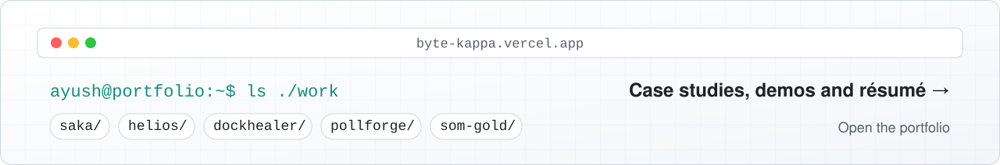
  </picture>
</a>

  Building agents, platforms or developer tools? I'd like to hear about it: <a href="mailto:ab262133@gmail.com"><b>ab262133@gmail.com</b></a> · <a href="https://www.linkedin.com/in/ayush-bansal-21b12a311/">LinkedIn</a>

