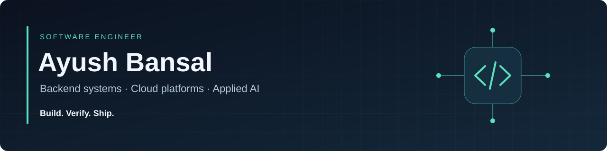

  

  <strong>Software engineer · AI agents · Backend systems · Cloud infrastructure</strong>

  <a href="https://byte-kappa.vercel.app/#work"><strong>Portfolio</strong></a> &nbsp;·&nbsp;
  <a href="https://www.linkedin.com/in/ayush-bansal-21b12a311/">LinkedIn</a> &nbsp;·&nbsp;
  <a href="mailto:ab262133@gmail.com">Email</a> &nbsp;·&nbsp;
  <a href="https://github.com/Ayush-Bansal08?tab=repositories">Repositories</a>

Hi, I'm Ayush 👋
I build software that does things, not just demos things: autonomous AI agents, reliable backend services, developer tooling, and cloud-native infrastructure.
- 🥈 ETHGlobal Mumbai 2026: 2nd place — 0G Private Computer with SAKA, our autonomous AI DeFi agent.
- 💼 Software Engineering Intern, Finn (Airforge Tech): 25+ merged PRs across 5+ production services.
- 🔬 AI/ML Research Intern, UNSW Sydney: hyperspectral mineral exploration, reproducible experiments, and research paper coauthorship.
- 🏆 LNMHacks 8.0: partner prize winner in the Viral Consumer Apps track.
- 🎓 B.Tech, Electronics & Communication Engineering, LNMIIT Jaipur · graduating 2028.
Open to software engineering internships and opportunities in backend, AI/ML, cloud/platform engineering, and developer infrastructure. You can see more of my work on my portfolio.
🥈 Featured: SAKA — Autonomous AI DeFi Agent
ETHGlobal Mumbai 2026 · 2nd place, 0G Private Computer · $1,500 prize

What if your AI could watch the market, make a decision within your rules, and show you exactly why it acted — without waiting for a prompt?

That's what our team built with SAKA, an autonomous AI financial agent. It monitors on-chain and market conditions, reasons over them through 0G Private Computer, and proposes or executes permitted DeFi actions through Uniswap.

SAKA is designed around verifiable decisions and guardrails, rather than blindly letting an LLM move funds:
- Proactive autopilot: nine detectors monitor positions and market events, including price moves, profit targets, liquidity-range changes, and risky hooks; alerts can reach users through Telegram.
- An end-to-end safety pipeline: transaction preparation, deterministic risk scoring, simulation, an independent 0G AI guard, policy checks, approval when required, and execution.
- Uniswap integration: a custom, unsigned-only MCP server with 16 typed tools for swaps, liquidity operations, pool comparison, and v4 hook analysis.
- Auditability: decisions and their evidence are recorded using 0G Storage, including refusals and executed transactions.
- Real engineering: React/TypeScript frontend, Fastify API, PostgreSQL, Redis, BullMQ workers, Privy wallets, and cloud deployment. The repository documents 600+ automated tests.
Built for Ethereum Sepolia testnet execution; Ethereum mainnet is read-only for market data.

Explore SAKA's source → · Live demo · Official ETHGlobal winning showcase
Selected engineering projects
Helios — Kubernetes Developer Platform
Go · Kubernetes · ArgoCD · Prometheus · Azure

Built a custom Go operator to provision preview environments and support GitOps-driven deployments with metric-based canary analysis. Includes namespace cleanup through Kubernetes finalizers.

Code · Operator implementation · Demo
DockHealer — AI-assisted Dockerfile Repair
Python · Docker · Ollama · pytest

A local-LLM CLI that generates Dockerfiles, builds and smoke-tests images, diagnoses failures, and runs a bounded repair loop. Includes 186 documented automated tests and a separate real Docker/Ollama evaluation protocol.

Code · Tests · Evaluation protocol
PollForge — Event-driven Voting Platform
Flask · Redis · .NET · PostgreSQL · Node.js · Azure AKS

A five-service voting system with queued writes, asynchronous persistence, WebSocket updates, Kubernetes deployment, Prometheus monitoring, and GitHub Actions delivery through Azure OIDC.

Code · Architecture · Demo
Research & experience
UNSW Sydney — AI/ML Research Intern · May–August 2026

Worked with Dr. Rohitash Chandra on hyperspectral mineral exploration, using self-organising maps and representation learning. Identified and corrected a training defect that improved reported mineral recall from 0% to 76.6%, audited eight pipeline issues, and ran stability and ablation experiments.

Research: SOM-Gold: Comparative Representation Learning Framework for Hyperspectral Mineral Exploration (2026) · coauthor · under review.

Research code · Paper citation

Finn / Airforge Tech — Software Engineering Intern · May–July 2026

Shipped 25+ merged PRs across 5+ production services spanning AI voice agents, backend APIs, authentication, WhatsApp automation, and product dashboards. Worked with Docker, Kubernetes, Nginx, and CI/CD.
Tools I use
Backend & data	Cloud & platform	AI & evaluation
Go, Python, TypeScript, JavaScript	Docker, Kubernetes, Azure, Terraform	0G, Ollama, LangChain, Hugging Face
Node.js, Fastify, Flask, Express	GitHub Actions, ArgoCD, Argo Rollouts	scikit-learn, NumPy, Pandas
PostgreSQL, Redis, MongoDB	Linux, Nginx, Prometheus, Grafana	pytest, Vitest, reproducible experiments

  <strong>Let's build something useful.</strong> 
  <a href="https://byte-kappa.vercel.app/#work">Portfolio</a> ·
  <a href="https://www.linkedin.com/in/ayush-bansal-21b12a311/">LinkedIn</a> ·
  <a href="mailto:ab262133@gmail.com">Email</a>

